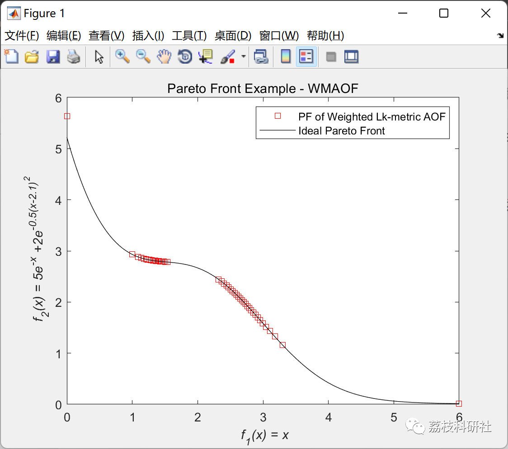
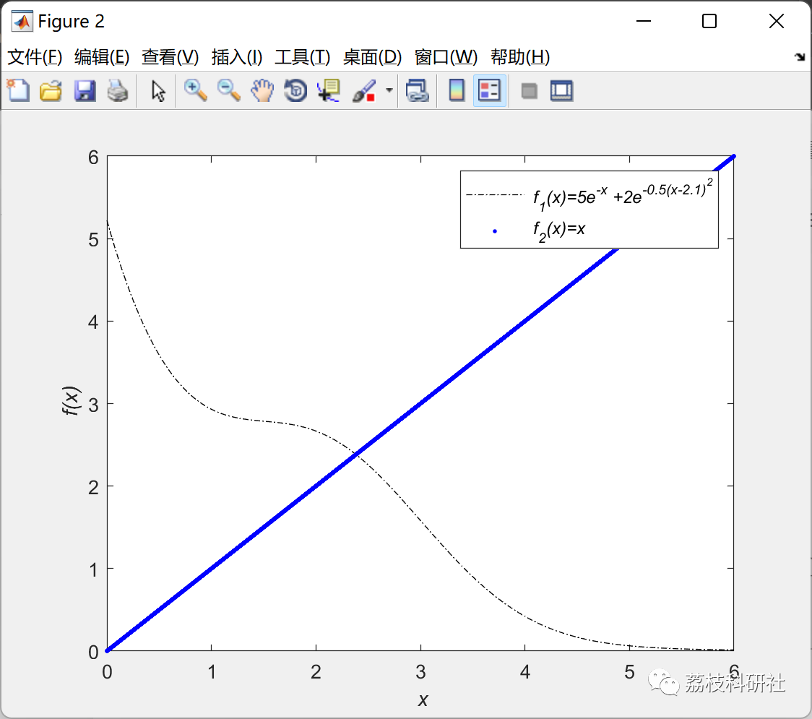

# Intelligent Power Dispatch Decision Method Based on Decomposition Multi-Objective Evolutionary Algorithm (Matlab Code Implementation)

💥💥💥💞💞💞💞 Welcome to this blog❤️❤️❤️💥💥💥
🏆 Bloggers' Advantage: 🌞🌞🌞 The content of the blog strives to be rigorous in thought and clear in logic, for the convenience of readers.
⛳️ Mantra: The journey of a hundred miles is half done in the last ninety.
🎁Column Directory:
🌈🌈🌈[Electrical Codes, Intelligent Algorithms and Their Applications, Neural Network Prediction, Path Planning, Optimized Scheduling, Workshop Scheduling, Image Processing, Signal Processing, Romantic Her, Complete Code Matters]🌟🌟🌟
💥1 Overview
In recent decades, there has been an increasing need to quickly resolve multi-objective power flow (MOPF) problems [2] in order to operate and plan modern power systems more effectively [4]. MOPF can be understood as an extension of constrained single-objective optimal power flow (OPF), aiming to minimize the total generation cost of the power system while meeting the demand for power balance between supply and demand, but is constrained by the operational limits of generators' active and reactive powers, as well as the overall system's safety.
MOPF is typically solved using the Multi-Objective Optimization (MOO) [7] algorithm, which takes into account several conflicting objectives with varying levels of trade-off. As a result, MOPF provides a set of optimal solutions rather than a single optimal value as in traditional OPF. The set of optimal solutions for MOPF corresponds to different trade-off levels, commonly referred to as Pareto Optimal Solutions (PoSs) [8]. Each PoS corresponds to a point in the objective space formed by different objectives, known as the Pareto Front (PF). Users can wisely decide which trade-off level and the most relevant best points on the PF that are most suitable for the power system's objectives.
According to [9]-[12], the optimization techniques for MOPF can be divided into two groups: 1) mathematical programming methods and 2) heuristic algorithms.
Even when dealing with large-scale MOPFs, mathematical programming methods [13] typically compute quickly and can consistently obtain the optimal solution each time. However, these methods rely on the use of derivatives, which are easily trapped in local optima. Additionally, for non-convex problems, they may not converge to the global optimum.
This article separately studies three aggregate objective functions (AOF), namely the weighted sum, Chebyshev and weighted Lk metrics. This time only the algorithm is explained.
📚2 Running Results
🎉3 Matlab code implementation
% Plot the Pareto Front\nfigure(1)\n; plot(PF(:,1), PF(:,2), 'rs');\n hold on\n​\nxlabel('\it f_{1}(x) = x')\n;ylabel('\it f_{2}(x) = 5e^{-x} +2e^{-0.5(x-2.1)^{2}}');\ntitle('Pareto Front Example - Tschebysheff');\n  
Click "Read Full Content" at the bottom left corner of the article or reply with the keyword: Decomposed Multi-Objective Evolutionary Algorithm
👨‍💻4 References
C. Xiao, D. Sutanto, K. M. Muttaqi and M. Zhang, "A Judicious Decision-Making Approach for Power Dispatch in Smart Grid Using a Multiobjective Evolutionary Algorithm Based on Decomposition," in IEEE Transactions on Industry Applications, vol. 56, no. 2, pp. 1918-1929, March-April 2020, doi: 10.1109/TIA.2019.2960478.  
​  

## Images

<!-- PAYMENT_BLOCK -->

## Get this dataset

- Payment link (Stripe): [Buy now](https://buy.stripe.com/3cs8yP7sY87d0vu9AB)
- Payment QR code: 

<!-- /PAYMENT_BLOCK -->
